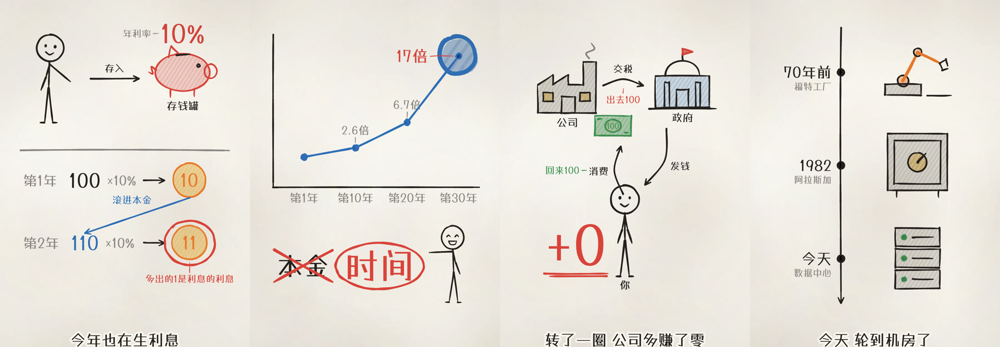
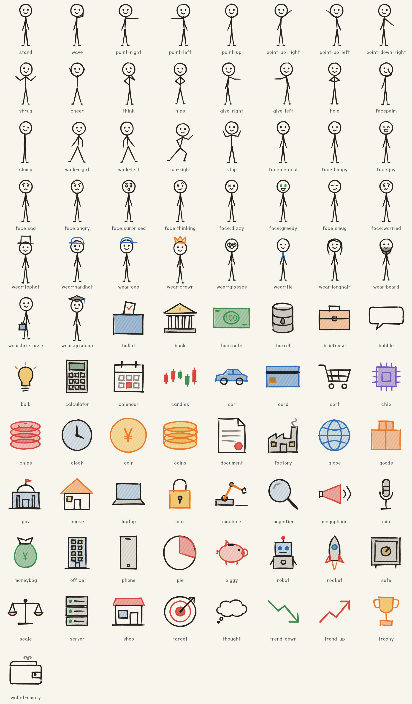

# 画讲 huajiang

[](https://github.com/milesradford99/rough/actions/workflows/ci.yml)

把**带逐字时间表的口播**做成“边画边讲”的手绘视频：一笔一笔画出来，画面和声音逐字同步，像一个人站在白板前讲给你听。

这是一个给 AI agent 用的底座。agent 读口播、写分镜（YAML），框架负责构图、避让、笔速、质感和渲染，并在出片前拦住“抄字幕、像 PPT、画面稀疏、不同步”这些毛病。



> agent 请从 [AGENTS.md](AGENTS.md) 开始读。

## 它是怎么工作的

```
口播稿 + 逐字时间表 + 配音
        │
        ▼
   agent 写分镜 ──► hj check ──► 文字分镜表 ──► 关键帧 ──► 视频
   （一个场景一个文件）  质量检查    用户确认①     用户确认②
```

一个场景的分镜长这样。位置、大小、箭头走向、动作顺序都不用写，由“表现手法”负责；agent 只决定角色是谁、每一步卡在哪句话上：

```yaml
from: "咱们跟着一百块钱"
intent: 一张钞票从公司到政府、到你、再回公司，公司一分没多赚。
pattern:
  kind: cycle
  nodes:
    - { id: company, doodle: factory, label: 公司 }
    - { id: gov, doodle: gov, label: 政府 }
    - { id: you, figure: stand, label: 你 }
  flows: [交税, 发钱, 消费]
  result: "+0"
beats:
  - at: "收走一百块税"          # 卡点写口播原文，换配音后自动跟随
    intent: 画出政府，钞票沿箭头滑过去
    do: [{ step: show.2 }, { step: go.1 }]
```

## 框架保证的事

这些不依赖写分镜的 agent 有多好的眼光：

| | |
|---|---|
| **不重叠、不出界** | 元素压到别的东西会被自动挪到最近的空位，连线自动绕路，批注自动换边；不写位置的元素自动找空地 |
| **构图和编排** | 九种表现手法各自带一套验证过的构图和动作顺序 |
| **同步** | 卡点绑定口播原文；画的速度自动匹配语速；整片和分段渲染的音画对齐有自动测试 |
| **质感** | 手写马克笔字体按真实笔顺写出；墨线有粗细变化；纸面有纹理；马克笔式涂色 |
| **流程** | 用户没确认文字分镜不出图，没确认关键帧不渲染；确认后改了“画什么”，确认自动失效 |
| **质量底线** | 照抄口播的板书直接报错；画得太赶、画面静止、信息稀疏、纯文字场景都会警告，没处理的警告原样出现在给用户的分镜表里 |
| **可返工** | 一个场景一个文件，位置与时间分开写，可以只看一帧、只渲染一段 |

## 九种表现手法

循环流转、两相对比、因果链、柱子被砍、走势、时间线、想法泡泡、等式、怎么分。`npx hj patterns <名字>` 会打印参数、步骤和一个能照着改的完整场景。


## 内置素材

可摆姿势、换表情、戴配饰、手里拿东西、能走动的火柴人；120 个同一画风的手绘件（含 Claude 像素形象的五个表情，和 32 个 Open Peeps 真人插画：坐、蹲、站、半身）；另有 5000+ 线条图标兜底。不够时用基本图形自己画（一个 YAML 文件），或用 `hj import` 把 Excalidraw 素材库、SVG、Quick Draw 简笔画转进来。



## 快速开始

需要 Node 20 或更高版本，以及 ffmpeg。渲染不依赖浏览器。

```bash
npm install
```

```bash
npx hj check examples/compound
```

```bash
npx hj stills examples/compound
```

```bash
npx hj render examples/compound
```

成片在 `examples/compound/out/video.mp4`。两个示例都用匀速的假时间表，没有配音：

- `examples/compound`：一段 24 秒的“复利”讲解，两块信息密集的板。
- `examples/patterns`：九种表现手法各演示一遍。

做自己的片子：

```bash
npx hj init work/my-video --voice <配音材料目录> --format portrait
```

配音材料目录里需要 `alignment.json`（逐字时间表）和 `narration.wav`，格式见 [docs/voice-guide.md](docs/voice-guide.md)。之后的流程见 [AGENTS.md](AGENTS.md)。

## 文档

| | |
|---|---|
| [AGENTS.md](AGENTS.md) | 工作流、铁律、代码地图 |
| [docs/directing.md](docs/directing.md) | 导演手册：拆论证、选手法、信息密度、卡点 |
| [docs/reference.md](docs/reference.md) | 全部字段、动作、元素、手法 |
| [docs/revising.md](docs/revising.md) | 返工手册：修改意见对应改哪几行 |
| [docs/voice-guide.md](docs/voice-guide.md) | 给配音方的要求与时间表格式 |
| [CHANGELOG.md](CHANGELOG.md) | 版本记录 |

## 现状与边界

- **已验证**：全部引擎功能有自动测试（单元测试加端到端测试），含流程闸门、自动避让、九种手法在竖屏和横屏下展开、带音频渲染的音画对齐。两个示例在竖屏下逐帧人工看过，手法一览在横屏下也看过。
- **尚未验证**：还没有用真实配音完整做过一条正式的片子。同步的机制经过了测试，但卡点“听起来对不对”需要真实配音来检验。
- **音效是合成的**：默认是稀疏的短促落笔声。它不如真实录音自然，可以用 `sfxSamples` 换成自己的录音，或用 `sfx: false` 关掉。
- **不支持**：背景音乐；真人或手出镜；位图图片素材；浏览器实时预览；小人的侧身和坐姿。
- 元素移动之后，先前画好的箭头和标记不会跟着走。
- 一块板挤到找不到空位时，引擎会报警告而不是缩小元素。

## 开发

```bash
npm test
```

```bash
npm run typecheck
```

```bash
npm run check:examples
```

## 致谢与许可

MIT 许可。笔画引擎来自 [rough.js](https://github.com/rough-stuff/rough)（MIT，Preet Shihn），本仓库由它的 fork 改造而来，原引擎保留在 `src/rough/`。
文字使用 [霞鹜漫黑](https://github.com/lxgw/LxgwMarkerGothic)（SIL OFL 1.1），笔顺数据来自 [Make Me a Hanzi](https://github.com/skishore/makemeahanzi)，图标来自 [Tabler Icons](https://github.com/tabler/tabler-icons)。完整清单见 [THIRD_PARTY.md](THIRD_PARTY.md)。
